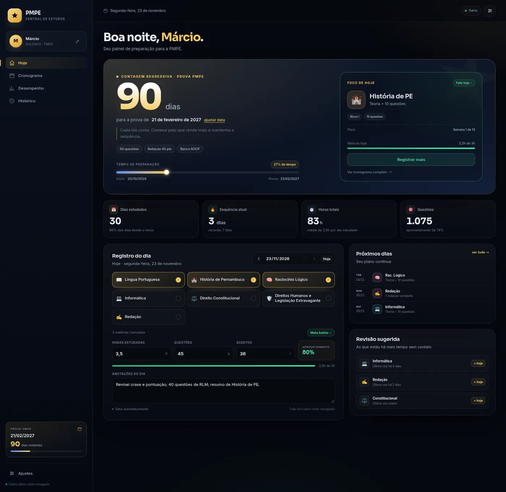
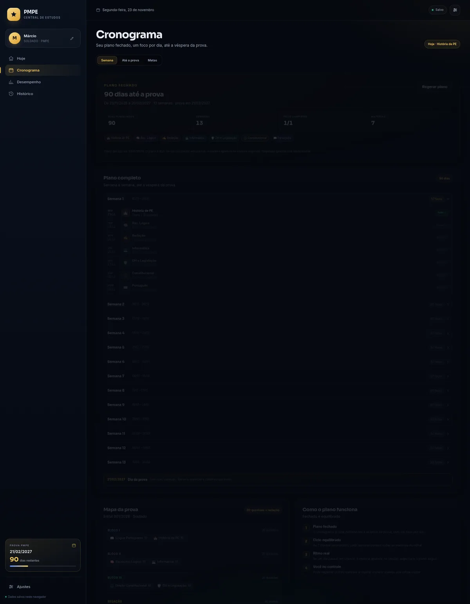
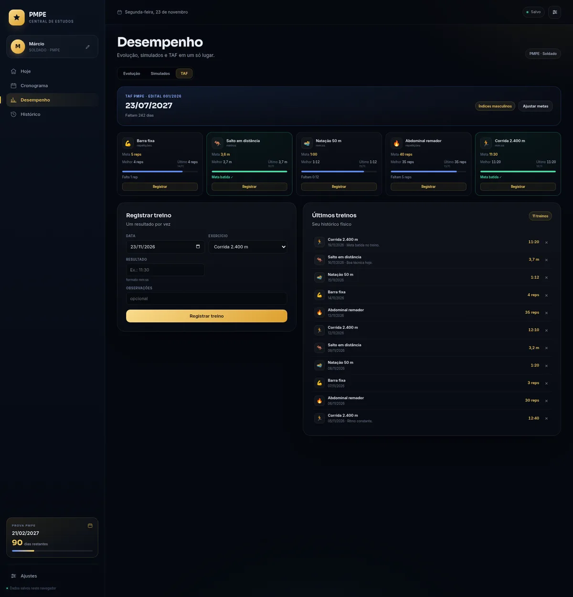

<div align="center">

# PMPE · Central de Estudos

**Uma plataforma pessoal, offline e open source para organizar a preparação para o concurso de Soldado da PMPE.**

**Demo:** https://ricardomarquesdev.github.io/estudos-pmpe/

[](https://github.com/ricardomarquesdev/estudos-pmpe/actions/workflows/ci.yml)
[](https://github.com/ricardomarquesdev/estudos-pmpe/actions/workflows/deploy.yml)


[Funcionalidades](#funcionalidades) · [Stack](#stack) · [Como rodar](#como-rodar) · [Deploy](#deploy-no-github-pages) · [Dados](#dados-e-privacidade)

</div>



### Cronograma e TAF

| Cronograma até a prova              | Módulo de TAF         |
| ----------------------------------- | --------------------- |
|  |  |

> **Aviso:** este é um projeto pessoal de estudos, sem vínculo com a PMPE ou com o Instituto AOCP. Datas, regras e índices devem ser sempre conferidos no edital oficial e na convocação.

## Sobre

A **Central de Estudos** reúne, em uma única interface, tudo o que eu precisava para estudar para o concurso de Soldado da PMPE:

- uma contagem regressiva para a prova;
- um cronograma fixo, já distribuído até a véspera da prova;
- metas de dias por matéria;
- registro diário de matérias, horas, questões e anotações;
- acompanhamento de simulados;
- preparação para o TAF;
- histórico, estatísticas e backup dos dados.

O projeto é uma SPA feita com **JavaScript puro em módulos ES**, sem backend. Todos os dados ficam no `localStorage` do navegador e não são enviados para nenhum servidor.

## Funcionalidades

### Hoje

- Saudação pessoal, contagem regressiva e anel de consistência.
- **Foco do dia** vindo do plano fixo, com tarefas e meta diária.
- Registro rápido: matérias, horas, questões, acertos e anotações.
- Resumo de sequência, horas e aproveitamento.
- Próximos dias e revisão sugerida.

### Cronograma

- **Plano fechado até a prova:** um foco por dia, de hoje até a véspera da prova (90 dias e 13 semanas na referência inicial).
- Ciclo equilibrado: as sete frentes se revezam e cada semana contém todas as matérias.
- Tarefas que evoluem de teoria para revisão e simulado.
- Plano completo semana a semana, com status `Feito`, `Hoje`, `Outro foco`, `Sem registro` e `Previsto`.
- Possibilidade de regerar o plano e ajustar o foco quando a rotina mudar.
- Mapa da prova e explicação do funcionamento do plano.

### Metas por matéria

- Meta de dias para cada uma das sete frentes.
- Progresso individual, dias feitos e dias reservados pelo plano.
- Integração com as barras de desempenho.

### Simulados

- Registro de data, título, questões, acertos, nota da redação, tempo e observações.
- Resumo com total, média, melhor e último resultado.
- Histórico e remoção de simulados.

### TAF

- Os cinco testes do edital: barra fixa, salto em distância, natação 50 m, abdominal remador e corrida 2.400 m.
- Índices oficiais do edital para os perfis **masculino** e **feminino**, com metas editáveis.
- Registro de treinos, melhor/último resultado, progresso e countdown para o TAF.
- Histórico e remoção de treinos.

### Histórico e dados

- Histórico completo filtrável por matéria.
- Exportação CSV do diário de estudos.
- Backup JSON completo (diário, plano, metas, simulados e TAF).
- Importação de backup e restauração.
- Dados salvos automaticamente, com indicador na barra superior.

### Interface

- Layout responsivo para desktop, tablet e celular.
- Menu lateral no desktop e barra inferior no celular.
- Tema escuro, estados de foco, tipografia e componentes acessíveis.
- Respeito a `prefers-reduced-motion`.

## Stack

| Camada    | Tecnologia                                                 |
| --------- | ---------------------------------------------------------- |
| UI        | HTML semântico, CSS moderno e JavaScript puro (ES Modules) |
| Build     | Vite                                                       |
| Testes    | `node:test` + `node:assert/strict`                         |
| Qualidade | ESLint + Prettier                                          |
| CI/CD     | GitHub Actions + GitHub Pages                              |

Sem dependências de runtime. O único objetivo de dependências de desenvolvimento é build, lint e testes.

## Arquitetura

```text
.
├── index.html
├── src/
│   ├── main.js                 # entrada da aplicação
│   ├── app.js                  # ações, eventos, orquestração e inicialização
│   ├── core/
│   │   ├── constants.js        # matérias, TAF, chaves e limites
│   │   ├── dates.js            # utilitários e formatadores de data
│   │   ├── dom.js              # seletores e download
│   │   ├── state.js            # estado, migração, sanitização e persistência
│   │   ├── taf.js              # parsing/formatação dos resultados do TAF
│   │   ├── ui-state.js         # data selecionada, view e abas
│   │   └── utils.js            # clamp, uid, escape, cores e saudação
│   ├── services/
│   │   ├── backup.js           # CSV, backup JSON e validação
│   │   ├── plan.js             # geração e leitura do plano fixo
│   │   ├── simulados.js        # cálculo de notas dos simulados
│   │   ├── stats.js            # estatísticas, sequência e metas
│   │   └── taf.js              # estatísticas dos treinos do TAF
│   ├── ui/
│   │   ├── feedback.js         # toasts e indicador de salvamento
│   │   ├── history.js
│   │   ├── log.js
│   │   ├── navigation.js
│   │   ├── performance.js
│   │   ├── profile.js
│   │   ├── schedule.js
│   │   ├── settings.js
│   │   ├── simulados.js
│   │   ├── stats.js
│   │   └── taf.js
│   └── styles/
│       ├── main.css
│       ├── base.css
│       ├── views.css
│       └── responsive.css
├── tests/                      # testes unitários das regras de negócio
└── .github/workflows/          # CI e deploy no GitHub Pages
```

A separação segue uma direção simples de dependências:

- `core` não conhece UI;
- `services` contém regras de negócio puras/testáveis;
- `ui` renderiza o DOM;
- `app.js` conecta os eventos, ações e renderizadores.

## Como rodar

### Requisitos

- Node.js **20.19+** (recomendado: 22 LTS)
- npm

```bash
git clone https://github.com/ricardomarquesdev/estudos-pmpe.git
cd estudos-pmpe
npm ci
npm run dev
```

Acesse `http://localhost:5173`.

### Scripts

| Comando                | O que faz                                     |
| ---------------------- | --------------------------------------------- |
| `npm run dev`          | Sobe o servidor de desenvolvimento            |
| `npm run build`        | Gera a versão de produção em `dist/`          |
| `npm run preview`      | Pré-visualiza o build                         |
| `npm test`             | Executa os testes com o runner nativo do Node |
| `npm run lint`         | Analisa o código com ESLint                   |
| `npm run lint:fix`     | Corrige problemas simples de lint             |
| `npm run format`       | Formata o projeto com Prettier                |
| `npm run format:check` | Verifica a formatação sem alterar arquivos    |

## Testes e qualidade

O projeto tem **30 testes unitários** cobrindo:

- datas e formatação;
- geração, validação e metadados do plano;
- migração e sanitização do estado;
- estatísticas, sequência e consistência;
- notas de simulados;
- parsing e status do TAF;
- CSV, backup e restauração.

O workflow de CI executa, em todo push e pull request:

```bash
npm ci
npm run format:check
npm run lint
npm test
npm run build
```

## Deploy no GitHub Pages

1. Crie um repositório no GitHub e envie o projeto para a branch `main`.
2. No repositório, abra **Settings → Pages**.
3. Em **Build and deployment**, selecione **Source: GitHub Actions**.
4. Faça um push na `main` (ou rode o workflow **Deploy no GitHub Pages** manualmente).

O workflow [`.github/workflows/deploy.yml`](.github/workflows/deploy.yml) builda o projeto e publica a pasta `dist`. O Vite está configurado com `base: './'`, então o app funciona em páginas de projeto (`usuario.github.io/repositorio/`).

## Dados e privacidade

- Tudo fica no **`localStorage` do navegador**, na chave `pmpe-painel-v1`.
- Não há backend, conta, analytics ou envio de dados.
- Limpar os dados do navegador apaga o histórico. Use **Ajustes → Seus dados → Baixar backup** regularmente.
- O armazenamento é por origem: `localhost`, o preview e o GitHub Pages têm bases separadas. Para levar os dados de um ambiente para outro, use o backup JSON.
- O app aceita backups da versão anterior (o estado é migrado pelo `stateFrom`).

### Migrando da versão de arquivo único

Se você usava a versão anterior em um único `index.html`:

1. Abra a versão antiga.
2. Vá em **Ajustes → Seus dados → Baixar backup**.
3. Abra a nova versão e importe o arquivo em **Ajustes → Seus dados → Importar backup**.

## Sobre os dados do edital

- Prova objetiva e redação: **21/02/2027** (Edital 001/2026 — Soldado, AOCP).
- TAF: janela de **23/07/2027 a 01/08/2027**.
- Índices do TAF usados como padrão: os do referido edital para Soldado/QOPM.
- O app é uma ferramenta de acompanhamento; não substitui o edital, a convocação ou orientação profissional.

## Licença

Distribuído sob a licença **MIT**. Veja [LICENSE](LICENSE).

Feito por [Márcio Marques](https://github.com/ricardomarquesdev).
